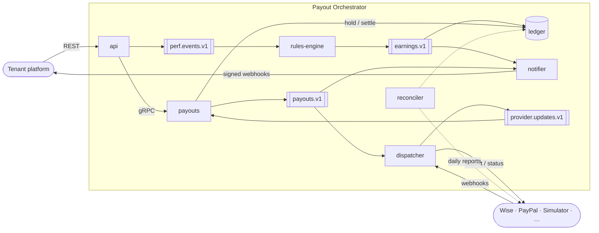
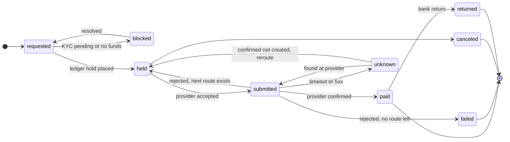

# Payout Orchestrator — Design

| | |
| --- | --- |
| **Status** | Draft v0.1 (first sketch, open for review) |
| **Author** | Gabriel Roriz |
| **Updated** | 2026-10-17 |
| **Scope** | [Project scope](01-scope.md) |

This is a first sketch of how to meet the [project scope](01-scope.md). Requirement ids (`FR-xx`, `NFR-xx`) refer to that document.

## 1. Architecture



| Service | Responsibility | Owns |
| --- | --- | --- |
| `api` | Public REST API, authentication, idempotency, event ingest | API keys, idempotency records |
| `rules-engine` | Consumes events, evaluates rules, emits earnings | Window aggregates, processed event ids |
| `ledger` | Double-entry book of record: balances and holds (gRPC) | The journal, which is the **source of truth** |
| `payouts` | Payout lifecycle, compliance gate, scheduling | The payout state machine |
| `dispatcher` | Routing, provider adapters, rate limits, circuit breakers, provider webhooks and polling | Provider attempts |
| `notifier` | Signed outbound webhooks with retries | Delivery log |
| `reconciler` | Scheduled job that compares provider reports with the ledger | Exceptions |

All services live in one Go module (`cmd/<service>`) and can run as a **single process in development**. Service boundaries are package boundaries first and network boundaries second.

## 2. Kafka topics

| Topic | Key | Producer → consumers |
| --- | --- | --- |
| `perf.events.v1` | `tenant:payee` | api → rules-engine |
| `earnings.v1` | `tenant:payee` | rules-engine → ledger, notifier |
| `payouts.v1` | `payout_id` | payouts → dispatcher, notifier |
| `provider.updates.v1` | `payout_id` | dispatcher → payouts |
| `<topic>.retry` / `<topic>.dlq` | same as the source topic | any consumer → ops tooling |

Payloads are versioned Protobuf, and CI runs `buf breaking` to catch incompatible schema changes.

## 3. Rules engine

Programs are data (FR-04, FR-05): YAML/JSON definitions whose filters are [CEL](https://github.com/google/cel-go) expressions, which are sandboxed, typed and fast. Changing a program needs no deploy. The cashback example from the scope:

```yaml
program: foodie-cashback
version: 1
effective_from: 2026-11-01T00:00:00Z
trigger:
  event: visit.completed
  filter: event.merchant.category == "restaurant"   # CEL expression
aggregate:
  window: calendar_month
  grace_period: 72h                                 # late events still count
  measure: count_distinct(event.merchant.id)
threshold: 10
reward:
  type: percent_of_sum
  field: event.amount
  rate: "0.05"
  rounding: half_even
  cap: { amount: 5000, currency: USD }              # minor units = $50.00
settlement: on_window_close
```

For each event, the engine:

1. Skips it if its `event_id` was already processed.
2. Finds the active rule versions whose trigger and filter match.
3. Updates the aggregate for `(rule version, payee, window)`.
4. Emits the difference between the reward the aggregate now implies and what was already accrued (decision 6 in §5).

## 4. Payout state machine



## 5. Key design decisions

1. **Postgres is the bank; Kafka is the nervous system.** Balances live only in the ledger's database. Kafka carries replayable facts between services.
2. **Transactional outbox** for every DB → Kafka publish. There are no dual writes.
3. **Effectively-once processing = at-least-once delivery + idempotency.** A consumer records each processed message id in the same DB transaction as its side effect. Unique constraints are the last line of defence.
4. **Partition by payee.** A payee's aggregates and ledger postings are owned by one consumer at a time, so no distributed locks are needed.
5. **Money is an `int64` amount in minor units plus an ISO-4217 currency code.** Rule math uses decimals with an explicit rounding mode. `float64` never touches money.
6. **Earnings are deltas, not totals:** `earning = reward(current window state) − amount already accrued for that window`. Retries, late events, reversals and cumulative snapshots (such as a post's running view count) all converge on the right number.
7. **Failover never acts on an ambiguous outcome.** Each adapter classifies every outcome:

   ```go
   var (
       ErrRejected  = errors.New("payout rejected by provider")   // definitive: safe to reroute
       ErrRetryable = errors.New("provider temporarily failed")   // retry same provider, same key
       ErrUnknown   = errors.New("provider outcome unknown")      // resolve before anything else
   )

   type Provider interface {
       Name() string
       Supports(r Route) bool
       Submit(ctx context.Context, in Instruction) (Receipt, error)
       Status(ctx context.Context, idempotencyKey string) (Receipt, error)
   }
   ```

   The idempotency key sent to a provider is derived deterministically from `(payout, provider)`. An `unknown` payout is first retried with the same key or looked up with `Status`. It is rerouted only after the provider confirms it holds no transfer for that key.

## 6. Meeting the NFRs

| NFR | Mechanism |
| --- | --- |
| NFR-01 Correctness | Outbox and idempotent consumers (decisions 2–3), deterministic provider keys and safe failover (decision 7), property-based tests on ledger invariants, chaos runs against the simulator |
| NFR-03 Durability | Kafka: RF=3, `min.insync.replicas=2`, `acks=all`, idempotent producers. Postgres: synchronous replica plus point-in-time recovery |
| NFR-04 Availability | The ingest path only writes to Kafka. Retention ≥ 7 days (≈ 420 GB at RF 3) absorbs downstream outages |
| NFR-06, NFR-07 Throughput and scale | `perf.events.v1` starts at 48 partitions, leaving room to add consumers well past the 5k/s target. Per-provider token buckets in the dispatcher |
| NFR-08 Isolation | Per-tenant token buckets in `api` and `dispatcher`. The dispatcher schedules round-robin across tenants |
| NFR-09 Ordering | Partition key `tenant:payee` (decision 4) |
| NFR-10 Auditability | Earnings carry their event ids and rule version. Ledger tables are partitioned by month (~1.5B lines/year) |
| NFR-11 Security | KMS envelope encryption for bank details, decrypted only in the dispatcher. mTLS between services. Hashed API keys |
| NFR-12 Observability | OpenTelemetry context propagated in Kafka headers, so one trace spans every hop |
| NFR-13 Operability | Cooperative-sticky consumer rebalancing. Retry and DLQ topics, plus a replay CLI |

## 7. Tech stack

| Concern | Choice | Why |
| --- | --- | --- |
| Language | Go (latest stable) | Strong concurrency model, single static binaries, widely used in payments infrastructure |
| Streaming | Apache Kafka 4.x (KRaft) locally · Amazon MSK on AWS | Durable, partitioned, replayable log |
| Kafka client | [franz-go](https://github.com/twmb/franz-go) | Pure Go (no cgo), supports transactions, high throughput |
| Database | PostgreSQL · pgx v5 · sqlc · goose | SQL-first and type-safe, without an ORM |
| Rules | cel-go | Sandboxed, typed expression language, also used by Kubernetes |
| APIs | REST/JSON + OpenAPI 3.1 (public) · ConnectRPC/gRPC (internal) | What tenant developers expect outside, typed contracts inside |
| Schemas | Protobuf + buf | Breaking-change detection in CI |
| Observability | OpenTelemetry · Prometheus · Grafana · `log/slog` | Traces that span Kafka hops |
| Testing | testcontainers-go · rapid (property-based) · k6 (load) · provider simulator | Real dependencies in tests, checks on ledger invariants, fault injection |
| Infra | Docker Compose (local) · Terraform (AWS: MSK, RDS, EKS) | One command locally, everything as code in the cloud |

## 8. Milestones

| Milestone | Scope | Demo / exit criteria |
| --- | --- | --- |
| **M0** Foundations | Repo layout, Docker Compose (Kafka, Postgres, Grafana), CI (lint, test, buf), outbox and consumer framework (retry, DLQ, idempotency, tracing) | `make up` starts the stack, and a test event flows end to end with a single trace |
| **M1** Money core | Ledger, payout state machine, simulator provider, notifier | Fund a wallet → pay a payee → receive a signed webhook, with the ledger balanced |
| **M2** Orchestration | Routing policies, one or two sandbox adapters, circuit breakers, failover that never acts on an ambiguous outcome, polling | Kill a provider in the middle of a 100k batch: **0 duplicates, 0 lost**, every payout in a terminal state |
| **M3** Performance engine | Programs, CEL rules, windows, reversals, late events | 10 restaurant visits (with duplicates, out-of-order events and one refund) → exactly 5% cashback paid |
| **M4** Production-grade | Reconciliation, DLQ replay tool, backtests, load tests against the NFR targets, chaos tests, Terraform for AWS | NFR-05 and NFR-06 met under k6 load, with a clean reconciliation report |

## 9. Open questions

1. **v1 providers:** which sandboxes can we realistically get access to (Wise, PayPal, Dots, Stripe Connect)?
2. **Deployment:** local-first with AWS in M4 (assumed), or AWS from day one?
